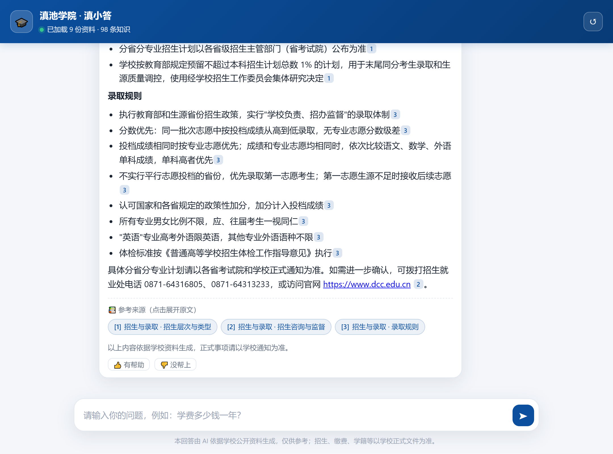

# 校园 AI 客服（云南大学滇池学院）

一个可以直接部署的高校智能问答系统。基于 **RAG（检索增强生成）**：
先用 BM25 + 语义向量在知识库里找资料，再让大模型**只依据找到的资料**作答，
每条回答都带原文出处，查不到就如实说查不到并引导到官方渠道。

```
用户提问
   │
   ├─ 安全护栏（拒绝越权提问 / 跑题）
   ├─ 混合检索：BM25 关键词 + 向量语义 → RRF 融合
   ├─ 相关度门槛：IDF 加权覆盖度 < 0.42 → 直接兜底，不硬答
   ├─ 拼装系统提示词（学校档案 + 检索片段）
   └─ 大模型流式生成 → 带 [1][2] 出处标注
```



## 一、30 秒跑起来

项目里已经装好了依赖（`.libs/`），**不联网也能直接启动**：

```powershell
# Windows
.\run.ps1
```

```bash
# Linux / macOS
bash run.sh
```

或者手动分两步：

```powershell
$env:PYTHONPATH = ".libs"
python scripts/build_index.py
python -m uvicorn app.main:app --port 8000
```

打开 <http://127.0.0.1:8000> 就能对话。

> **没配 API Key 也能用**：此时系统自动进入「纯检索模式」，
> 直接把知识库里最相关的原文整理出来，链路完全一致，只是没有语言润色。

## 二、接入大模型（1 分钟）

编辑 `.env`：

```ini
LLM_API_KEY=sk-你的密钥
LLM_BASE_URL=https://api.deepseek.com/v1
LLM_MODEL=deepseek-chat
```

任何 **OpenAI 兼容** 接口都能用，常见选择：

| 服务商 | `LLM_BASE_URL` | `LLM_MODEL` 示例 |
| --- | --- | --- |
| DeepSeek | `https://api.deepseek.com/v1` | `deepseek-chat` |
| 阿里通义千问 | `https://dashscope.aliyuncs.com/compatible-mode/v1` | `qwen-plus` |
| 智谱 GLM | `https://open.bigmodel.cn/api/paas/v4` | `glm-4-flash` |
| 月之暗面 Kimi | `https://api.moonshot.cn/v1` | `moonshot-v1-8k` |
| 硅基流动 | `https://api.siliconflow.cn/v1` | `deepseek-ai/DeepSeek-V3` |
| 校内自建 vLLM | `http://10.0.0.5:8000/v1` | 你的模型名 |

改完重启服务，访问 `/api/health` 会显示 `"llm_enabled": true`。

## 三、向量化怎么选

默认 `EMBEDDING_PROVIDER=local`，用内置的 **TF-IDF + SVD（LSA）** 做语义检索：
纯 numpy 实现，**不下载模型、不联网、零额外费用**，配合 BM25 已能满足校园问答。

想要更强的语义理解，可以换成神经向量模型：

```ini
EMBEDDING_PROVIDER=api
EMBEDDING_API_KEY=sk-xxx
EMBEDDING_BASE_URL=https://api.siliconflow.cn/v1
EMBEDDING_MODEL=BAAI/bge-m3
```

改完必须**重建索引**（管理接口或 `python scripts/build_index.py`）。
如果接口临时不可用，系统会自动退回关键词检索并记日志，不会直接报错。

## 四、维护知识库（最重要的事）

### 3 种更新方式

**1）直接放文件**（推荐）

把学校资料丢进 `data/knowledge/`，然后重建索引：

```powershell
python scripts/build_index.py
```

```bash
curl -X POST http://127.0.0.1:8000/api/admin/reindex -H "X-Admin-Token: 你的令牌"
```

**2）网页后台上传**

```bash
curl -X POST http://127.0.0.1:8000/api/admin/upload \
  -H "X-Admin-Token: 你的令牌" \
  -F "files=@招生简章.md" -F "files=@新生入学须知.txt"
```

**3）常见问答表**

`data/knowledge/08-常见问答.csv` 是最有效的一类资料，
一行一条问答，命中率极高。列名支持 `question/answer`、`问题/答案`、`q/a`。

### 支持的格式

| 格式 | 说明 |
| --- | --- |
| `.md` | 按标题层级切分，最好的格式 |
| `.txt` | 按段落切分 |
| `.csv` | 一行一条问答，字段用 `question,answer` |
| `.json` / `.jsonl` | 问答数组，字段同上 |

PDF 请先转成文本或 Markdown 再放进来。
文件名以 `_` 开头的内容（如 `_待核对清单.md`）**不会入库**，可当备忘录用。

### 哪些内容该放进来

招生简章、专业介绍、新生入学须知、学生手册、教务办事指南、
奖助政策、校园卡/宿舍/图书馆说明、常见问答——**都是学校已经公开的资料**。

不要放：含个人隐私的文件、未公开的内部文件。

### 补哪些内容最划算

系统会自动记录**没答上来的问题**，这是最该优先补的资料清单：

```bash
curl "http://127.0.0.1:8000/api/admin/misses?days=7" -H "X-Admin-Token: 你的令牌"
```

## 五、回答质量调参

都在 `config.yaml` 的 `retrieval` 段：

| 参数 | 默认 | 作用 |
| --- | --- | --- |
| `min_coverage` | `0.42` | **最关键**。问题关键词被资料覆盖的比例低于此值，就回答「没查到」。调高更保守 |
| `min_score` | `0.18` | 融合后的相关度下限 |
| `top_k` | `5` | 送给大模型的资料条数。调大更全面，但更慢、更贵 |
| `candidate_k` | `12` | 每路检索先召回多少条再融合 |
| `chunk_size` | `450` | 资料切片长度（字符） |

### 调参前先跑回归，别直接凭感觉改阈值

```bash
python scripts/qa_regression.py            # 22 个真实问题 + 5 个跑题问题
python scripts/qa_regression.py --sweep    # 扫一遍阈值，看召回/误答怎么变
python scripts/qa_regression.py --list-misses
```

实测结论（滇池学院现有知识库、96 个片段）：

| `min_coverage` | 召回 | 漏答 | 跑题误答 |
| --- | --- | --- | --- |
| `0.42`（默认） | 19/22 | 3 | 0 |
| `0.35` | 19/22 | 3 | 0 |
| `0.30` | 20/22 | 2 | 2 |
| `0.25` | 20/22 | 2 | 4 |

**调低阈值几乎换不来召回，却会立刻让跑题问题被硬答**，所以它不该用来兜语法差异。
那些"资料里明明有却答没查到"的问题，根因通常是**提问用词和资料用词不一致**
（用户问「以前叫什么名字」，资料写「前身是…2023 年转设更名」），正确做法是
**在知识库里补一条同义问法的常见问答**——`08-常见问答.csv` 的每条都会把问题
原文一起入库，所以补一行的命中率提升比调参数大得多。

改完知识库记得重建索引，再跑一次 `qa_regression.py` 确认没有回退。

> 另外提醒：语料很小的时候 IDF 会失真，个别口语词（如「钱」）因为只在
> 一条问答里出现过，会拿到全语料最高权重，把真正该命中的条目挤出阈值。
> 遇到这种情况同样是补问答最省事，而不是全局降低 `min_coverage`。

## 六、挂到学校官网上

在官网任意页面的 `</body>` 前加一行：

```html
<script src="https://你的域名/widget.js"
        data-api="https://你的域名"
        data-color="#0B4F9E"
        data-title="滇池学院智能客服"
        data-position="right"
        defer></script>
```

右下角会出现悬浮按钮，点开即对话。也可以直接 iframe 嵌入：

```html
<iframe src="https://你的域名/" style="width:100%;height:680px;border:0"></iframe>
```

## 七、接口清单

| 方法 | 路径 | 说明 |
| --- | --- | --- |
| GET | `/api/meta` | 学校信息、主题色、推荐问题、索引状态 |
| POST | `/api/chat` | 一次返回完整回答，适合第三方系统对接 |
| POST | `/api/chat/stream` | SSE 流式返回，网页端用这个 |
| POST | `/api/feedback` | 赞 / 踩 反馈 |
| POST | `/api/session/reset` | 清空会话上下文 |
| GET | `/api/health` | 健康检查 |
| GET | `/docs` | 自动生成的接口文档 |

对话请求体：

```json
{ "question": "学费一年多少钱？", "session_id": null }
```

`session_id` 传上次返回值即可获得多轮上下文（默认保留 4 轮）。

### 管理接口（需请求头 `X-Admin-Token`）

| 方法 | 路径 | 说明 |
| --- | --- | --- |
| GET | `/api/admin/stats` | 提问量、命中率、模式分布、热点问题 |
| GET | `/api/admin/misses` | 未命中的问题清单 |
| GET | `/api/admin/documents` | 知识文件清单与切片数 |
| POST | `/api/admin/reindex` | 重建索引 |
| POST | `/api/admin/upload` | 上传知识文件并自动重建 |
| DELETE | `/api/admin/document?path=xxx.md` | 删除知识文件 |
| GET | `/api/admin/preview-prompt` | 查看当前系统提示词（给校方审话术用） |
| GET | `/api/admin/llm-check` | 测试大模型连通性 |

## 八、部署

### Docker

```bash
docker compose up -d --build
```

`data/` 已挂载出来，改完资料重启容器或调一次 `/api/admin/reindex` 即可。

### 裸机 + Nginx

```bash
python -m uvicorn app.main:app --host 127.0.0.1 --port 8000 --workers 2
```

```nginx
server {
    listen 443 ssl;
    server_name ai.example.edu.cn;
    location / {
        proxy_pass http://127.0.0.1:8000;
        proxy_http_version 1.1;
        proxy_set_header Host $host;
        proxy_set_header X-Real-IP $remote_addr;
        proxy_set_header X-Forwarded-For $proxy_add_x_forwarded_for;
        proxy_buffering off;
        proxy_cache off;
        proxy_read_timeout 300s;
    }
}
```

`proxy_buffering off;` 是流式输出必需的，否则回答会一次性蹦出来。

> 部署到公网前请务必：
> 1. 把 `.env` 里的 `ADMIN_TOKEN` 改成随机长字符串；
> 2. 把 `config.yaml` 的 `server.cors_origins` 从 `["*"]` 收紧为学校官网域名；
> 3. 确认 `--workers` 数量与服务器内存匹配（索引会常驻内存）。

## 九、目录结构

```
app/
  main.py            FastAPI 入口、启动时自动建索引
  settings.py        config.yaml + .env 配置加载
  chunking.py        文档切片（Markdown 标题感知）
  bm25.py            BM25 关键词检索
  embeddings.py      本地 LSA 向量 / API 向量
  index_store.py     索引构建、加载、混合检索 + 相关度门槛
  rag.py             问答主流程、安全护栏、兜底策略
  prompt.py          系统提示词（人设与回答规则）
  llm.py             OpenAI 兼容客户端（流式/非流式）
  store.py           SQLite 日志：问答记录、反馈、统计
data/knowledge/      知识库（放学校资料的地方）
data/index/          索引产物（可删除后重建）
data/logs/chat.db    问答日志
web/index.html       聊天页面
web/widget.js        官网悬浮挂件
scripts/             索引、自检、回归测试、命令行问答、mock 模型
```

## 十、上线前检查清单

- [ ] 按 `data/knowledge/_待核对清单.md` 逐项填写并核对学校信息
- [ ] `config.yaml` 里的学校名称、官网、电话已改为官方信息
- [ ] 若学校已转设更名，`school.name` 已同步修改
- [ ] `.env` 的 `ADMIN_TOKEN` 已改为随机长字符串
- [ ] 跑 `python scripts/qa_regression.py`，召回和"跑题兜底"都符合预期
- [ ] 按 `_待核对清单.md` 把真实考生问题补进 `08-常见问答.csv` 并重建索引
- [ ] 确认 `.env` 既没进 Git，也没进过 Docker 镜像层：
      `git ls-files | findstr env` 应只有 `.env.example`；
      `docker run --rm <镜像> ls -a /app` 不应出现 `.env`
- [ ] 部署的 worker 数为 1（多 worker 会让多轮对话丢上下文，
      要扩展请先把 sessions / ratelimit 换成 Redis）
- [ ] `/api/admin/preview-prompt` 的话术经学校宣传部门审阅
- [ ] `cors_origins` 已收紧
- [ ] 全站 HTTPS

## 十一、已知限制与可扩展方向

**当前限制**

- 检索只看当轮问题；「那学费呢」这类追问会借助上一轮补全，但复合指代仍可能落空。
- 本地 LSA 向量对同义改写（「多少钱」vs「收费标准」）不如神经向量模型。
- 会话上下文存在内存里，多进程部署时会话不共享；如需集群请换成 Redis。

**容易加的扩展**

- 转人工：兜底话术里接企业微信 / 在线客服链接
- 语音输入：前端接浏览器 `SpeechRecognition`
- 小程序 / 公众号：复用 `/api/chat` 即可
- 答案审核：`store.py` 里已有问答日志，加一张审核表即可
- 反问澄清：相关度处于临界区间时，先追问用户具体想了解哪方面

## 十二、常见问题

**Q：启动报「知识库为空」？**
A：`data/knowledge/` 下没有可读文件，放一个 `.md` 再重建索引。

**Q：回答里出现「【待填】」？**
A：说明该知识文件还没替换模板占位符，按 `_待核对清单.md` 填写后重建索引。

**Q：页面提示「知识库已更新但索引未重建」？**
A：改完资料要执行一次 `POST /api/admin/reindex`。

**Q：回答总说「没查到」，但资料里明明有？**
A：多半是提法不一致（如资料写「毕业去向落实率」，用户问「就业率」；
资料写「转设更名」，用户问「以前叫什么名字」）。**首选在该文件里补一条
同义问法的问答**，然后重建索引。不要先动 `min_coverage`——实测降低阈值
几乎不涨召回，反而会让跑题问题被硬答（见第五节）。

**Q：不想花钱调模型，能测吗？**
A：可以。`python scripts/mock_llm.py` 起一个假模型，把 `LLM_BASE_URL`
指到 `http://127.0.0.1:8199/v1` 就能验证完整的大模型分支。

**Q：怎么不联网验证整体是否正常？**
A：`python scripts/smoke_test.py`，会跑分词、切片、建索引和 6 组检索回归。

## 十三、说明

项目中的知识库文件是**结构化模板**，带【待填】的字段需要替换为学校公开信息。
系统默认只依据知识库作答，不编造分数线、电话、链接，
招生类问题一律提示「以学校正式文件和各省招生考试院公布为准」。
