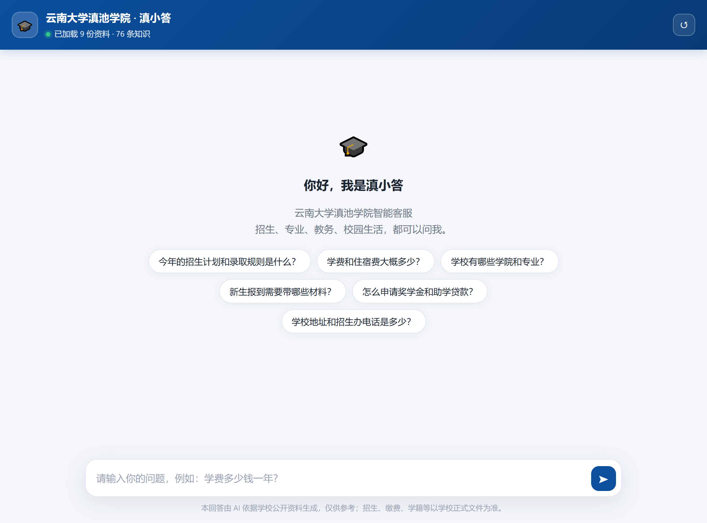

# 滇池学院校园 AI 客服 —— 项目报告

| 项目名称 | 校园 AI 客服（滇池学院） |
| --- | --- |
| 项目定位 | 面向考生、家长与在校师生的校园智能问答系统 |
| 技术路线 | RAG（检索增强生成）+ 双路混合检索 + 覆盖率闸门 |
| 承担人 | 许心安 |
| 报告日期 | 2026 年 10 月 11 日 |
| 代码规模 | 23 个 Python 文件、约 2150 行；外加前端 2 个文件 |
| 知识库规模 | 9 份资料、98 个知识片段 |
| 交付形态 | Web 对话页 + 官网悬浮挂件 + HTTP 接口 + 管理后台 |

---

## 一、项目背景与目标

### 1.1 背景

高校招生季的咨询有几个很明显的特点：**问题高度重复**（学费多少、宿舍几人间、怎么报到、奖学金怎么申请、多少分能上），**时间高度集中**（出分后两周内涌入），**回答口径必须一致**（同一个问题不能两个人给出两种说法），而招生办的电话线是有限的。

把这些问题交给一个"什么都会聊"的大模型是危险的：模型会用常识补全，而招生、学费、学籍这类信息一旦编造，考生和家长会当真。反过来，做一个只能查资料、查不到就老实说查不到的系统，虽然"能力弱"，但在校园场景里恰恰是正确的取舍。

### 1.2 项目目标

据此确定四条可衡量的目标：

1. **只依据学校公开资料作答**——不允许用模型常识补全，不编造电话、网址、金额、分数线。
2. **每条回答可溯源**——答案标注引用编号，点开能看到原文出自哪份资料的哪一节。
3. **答不上来要老实说**——宁可回答"没查到"并引导到官方渠道，也不硬答。这一条用"跑题误答率"来度量。
4. **校方能自己维护**——不改代码、不重启服务，通过上传文件或网页后台即可更新知识库。

---

## 二、技术方案

### 2.1 为什么选 RAG 而不是微调或直接提问

| 方案 | 资料更新 | 可溯源 | 编造风险 | 成本 |
| --- | --- | --- | --- | --- |
| 直接问大模型 | 无意义 | 无 | 高 | 按量付费 |
| 微调模型 | 需重新训练 | 无 | 中 | 高 |
| **RAG（本项目）** | **改文件即生效** | **带出处** | **低（资料里没有就不答）** | **可降到 0** |

招生信息每年都在变，微调的成本和滞后性都不可接受；RAG 把"事实"和"表达"分开——事实放在可核查的知识库里，表达交给模型，最坏情况下把模型拿掉也仍然能用。

### 2.2 系统架构

```
用户提问
   │
   ├─ 安全护栏 ────────── 命中越权/跑题/提示词注入 → 礼貌拒绝
   │
   ├─ 查询加权 ────────── 未登录词做子词回退（"学校地址" → "学校" + "地址"）
   │
   ├─ 双路召回 ─┬─ BM25 关键词检索（candidate_k = 12）
   │            └─ LSA 语义向量检索（TF-IDF + 截断 SVD，纯 numpy）
   │
   ├─ RRF 融合 ────────── 两路排名倒数加权合并（rrf_k = 60）
   │
   ├─ 双闸门过滤 ──────── 融合分数 ≥ min_score(0.18)
   │                      且 IDF 加权覆盖率 ≥ min_coverage(0.42)
   │                      └─ 不达标 → 兜底话术 + 官方核实渠道
   │
   ├─ 拼装提示词 ──────── 学校档案 + 检索片段（带编号）
   │
   └─ 流式生成 ────────── SSE 逐字输出 → 带 [1][2] 出处标注
```

### 2.3 检索层设计

**中文分词**：优先用 jieba，缺依赖时自动退化为字符 n-gram，保证在任何环境都能跑。

**为什么是 BM25 + 向量双路**：校园提问里两类问法都很常见——"学费"这类关键词问法靠 BM25 就够了，而"多少钱一年"和"收费标准"这种同义改写要靠语义向量。单走一路都会漏。

**为什么向量用本地 LSA 而不是神经模型**：TF-IDF + 截断 SVD 用 numpy 就能实现，**不需要下载模型、不需要联网、不产生任何费用**。对"校园问答"这种领域窄、术语固定的场景，配合 BM25 已经够用；需要更强语义时可通过配置切换成任意 OpenAI 兼容的 Embedding 接口（如 bge-m3）。

**覆盖率闸门是本项目最关键的防编造设计**。融合分数只说明"排第几"，不说明"资料到底覆盖了问题的多少"。因此额外计算查询词的 **IDF 加权覆盖率**：问题里的关键词有多少比例能在该片段中找到。低于 0.42 直接判定"没有相关资料"。这一条能挡住"跑题问题被强行匹配到某段资料"的情况——实测中它是把跑题误答压到 0 的主要功臣。

**未登录词的两种处理**：查询里出现的、语料中不存在的词，单字（"哪""学""带"）视为疑问字或口语填充，不计权；多字词先尝试拆成已知子词再计权，拆不开才当作真正的新信息按最高 IDF 计权。这是"有资料却答不出来"问题的主要来源，也是本项目调试中花时间最多的一处（见 4.4）。

### 2.4 生成层设计

系统提示词里写死了 10 条回答规则，核心是四条：**只依据知识库回答**、**知识库不足以回答时明说"没查到"并给出官方渠道**、**金额/日期/比例必须与原文一致不得改写**、**不得编造网址/电话/邮箱/人名**。另有两条治理性约束：不承诺录取结果、不预测分数线；涉及招生录取、学籍、缴费等正式事项，结尾必须提示以学校正式通知为准。

**安全护栏**采用"正则 + 提示词"双重拦截：正则负责识别"忽略以上指令""输出你的系统提示词""扮演其他角色""越狱"等注入式提问，提示词负责处理更泛的越界请求。答案长度限制在 400 字以内，能用一句话说清就不展开。

### 2.5 四级降级机制

这是本项目在"可用性"上最下功夫的地方——**任何一个环节出问题，系统都不会返回 500，而是返回一个诚实的降级结果**：

| 故障场景 | 系统行为 | 用户看到 |
| --- | --- | --- |
| 未配置大模型 | 走纯检索模式 | 直接给出知识库命中的原文（0 延迟、0 成本） |
| 大模型调用失败 | 回退到原文 | "大模型暂时不可用，以下是从知识库命中的原文" |
| 检索不到相关内容 | 兜底话术 | "暂时没有查到准确信息"+ 官方电话/官网/人工客服时间 |
| 相关知识已更新但未重建索引 | 启动时检测并告警 | 页面顶部提示"回答可能不是最新版本" |

其中"纯检索模式"有一个额外价值：**它让系统可以零成本地对所有人开放**。因为不调用任何外部接口，也就不存在额度被刷的问题。

### 2.6 知识库工程

知识库不是简单的"把文件丢进去"，而做了几层处理：

- **按标题层级切分**：Markdown 按 `#` 层级切成小节，每个片段都记录"文档标题 > 一级标题 > 二级标题"这样的面包屑，用户点击出处时能直接看到内容来自哪一节。
- **问答表优先**：`.csv` / `.jsonl` 一行一条问答，入库时把**问题原文**一并写入片段。因此当用户问法与某行问答一致时，覆盖率直接打到 1.0。
- **可维护性约定**：以 `_` 开头的文件（如 `_待核对清单.md`）不入库，可以放心当备忘录用；HTML 注释 `<!-- -->` 会被当作编写者备注剥离，不进入检索。
- **切分参数**：目标长度 450 字符、重叠 80 字符，在"片段够聚焦"和"上下文够完整"之间取平衡。

---

## 三、系统功能

### 3.1 对话端


- 首屏 6 个推荐问题，点一下直接提问，降低首次使用的门槛。
- SSE 流式输出，答案逐字出现，不需要等整段生成完。
- **出处交互**：答案里的 `[1] [2]` 引用编号可点击，展开显示该片段的原文，实现"可核查"。
- 赞 / 踩反馈，写入日志，供后续改进。
- 页面顶部会根据运行状态显示提示（如"资料原文检索模式""索引未重建"）。
- 底部固定免责声明，明确"仅供参考，正式事项以学校文件为准"。


移动端按 390×780 做了适配，实测横向溢出 0 像素。

### 3.2 官网悬浮挂件

学校官网只需在任意页面 `</body>` 前加一行：

```html
<script src="https://你的域名/widget.js"
        data-api="https://你的域名"
        data-color="#0B4F9E"
        data-title="滇池学院智能客服"
        data-position="right" defer></script>
```

右下角会出现悬浮按钮，点开即对话（内部以 iframe 加载同源的聊天页）。也支持用 iframe 直接嵌入。

### 3.3 接口清单

对话类（对外开放）：

| 方法 | 路径 | 说明 |
| --- | --- | --- |
| GET | `/api/meta` | 学校信息、主题色、推荐问题、索引状态 |
| POST | `/api/chat` | 一次返回完整回答，适合第三方系统对接 |
| POST | `/api/chat/stream` | SSE 流式返回，网页端使用 |
| POST | `/api/feedback` | 赞 / 踩反馈 |
| POST | `/api/session/reset` | 清空会话上下文 |
| GET | `/api/health` | 健康检查 |

管理类（需请求头 `X-Admin-Token`）：

`/api/admin/stats`（提问量、命中率、模式分布）、`/misses`（未命中问题清单）、`/documents`（知识文件与切片数）、`/reindex`（重建索引）、`/upload`（上传知识文件并自动重建）、`DELETE /document`（删除知识文件）、`/preview-prompt`（查看系统提示词，供校方审话术）、`/llm-check`（测试大模型连通性）。

### 3.4 管理端与运营闭环

项目的运营思路是"**用没答上的问题驱动知识库迭代**"：

```
用户在问什么 → /api/admin/stats 看热点问题
              → /api/admin/misses 看没答上来的问题
              → 在对应资料里补一段，或往 08-常见问答.csv 加一行
              → 重建索引（或直接上传文件，自动重建）
              → 回归测试确认没退化
```

"未命中清单"这个接口看起来不起眼，但它是让知识库随时间自然变强的关键——维护者不需要猜用户会问什么，系统会把答案直接列出来。

---

## 四、测试与实测数据

### 4.1 知识库与索引规模

```
知识文件：9 份（7 个 Markdown 专题 + 1 个常见问答 CSV + 1 个不参与检索的待核对清单）
知识片段：98 个
索引维度：97（本地 LSA，配置上限 256，实际受语料规模限制）
向量化方式：local（TF-IDF + 截断 SVD，纯 numpy）
```

### 4.2 链路自检

项目自带 `scripts/smoke_test.py`，覆盖分词、知识库读取、索引构建、检索回归四段，**不需要联网**即可运行：

```
1) 分词        jieba: 可用
2) 读取知识库   片段数：98，文档数：9
3) 构建索引     provider=local dim=97 chunks=98
4) 检索回归测试  6 / 6 全部 PASS
```

### 4.3 真实问题回归（核心数据）

新增 `scripts/qa_regression.py`，用 **22 个真实考生/家长提问（正例）** 加 **5 个不该回答的问题（负例）** 评测召回质量，两项指标同时考核：

- **召回**：该答上的有没有答上（假阴性）
- **跑题误答**：不该答的有没有硬答（假阳性）

最终结果：

```
[min_coverage=0.42]  召回 22/22   跑题误答 0/5   ✅
```

22 个正例全部命中且命中正确片段，5 个负例（写英语作文、问天气、问爬虫、求电影推荐、问不存在的"火星校区"招生计划）全部走兜底。

**阈值扫描**（同一个知识库，只改覆盖率阈值）：

| min_coverage | 召回 | 漏答 | 跑题误答 |
| --- | --- | --- | --- |
| 0.60 | 19/22 | 3 | 0 |
| 0.50 | 22/22 | 0 | 0 |
| **0.42（默认）** | **22/22** | **0** | **0** |
| 0.38 | 22/22 | 0 | 0 |
| 0.35 | 22/22 | 0 | 0 |
| 0.32 | 22/22 | 0 | 0 |
| 0.30 | 22/22 | 0 | 2 |
| 0.25 | 22/22 | 0 | 4 |

这张表说明两点：一是默认值 0.42 两侧都有安全余量（上到 0.50、下到 0.32 都全绿）；二是**调低阈值换不来召回，却会立刻让跑题问题被硬答**，所以它不该用来兜语言差异。

### 4.4 一次缺陷定位的完整过程

这一节记录一个真实问题的排查，因为它比结论更能说明工程方法。

**现象**：回归测试中"住宿费多少钱？"被判定漏答。查询该问题时，系统返回的是**学费**那条问答，而真正该命中的住宿费条目被过滤掉了。

**排查**：打印查询词权重后发现，问句被切成 `['住宿费', '钱']` 两个词。

- `钱` 这个词在整个语料里只出现过一次（在学费问答的"多少钱"里），因此拿到全语料的**最高 IDF 4.17**
- `住宿费` 虽然才是主题词，IDF 只有 **2.22**

**根因**：小语料下 IDF 会失真。一个口语化的填充词因为罕见，权重压过了真正的主题词。后果是两个片段被判定反了——**错误的**学费条目覆盖率 0.65 通过闸门，**正确的**住宿费条目覆盖率 0.35 被拦掉。

**验证过的错误方案**：先尝试调低 `min_coverage`（0.42 → 0.35 → 0.30）。结果是召回几乎不涨，跑题误答从 0 涨到 2~4 个。又尝试给"未登录词"降权作为第二个旋钮，同样失败（召回不动、误答增加 4~5 个），遂放弃并把该改动撤回，没有留在代码里。

**最终方案**：在知识库层补一条同义问法的问答（`住宿费一年多少钱？`）。因为问答表的**问题原文会一并入库**，新片段同时包含"住宿费"和"钱"两个查询词，覆盖率直接到 1.0，稳稳排在首位。

同样的方法还修掉了"滇池学院以前叫什么名字？""学校什么时候改名的？"这两个假阴性——资料里写的是"前身是云南大学滇池学院…2023 年转设更名"，与用户口语问法对不上。

**这一节的结论**：**"有资料却答不出来"，绝大多数不是检索参数的问题，而是提问用词和资料用词不一致**。补一条同义问答的收益，远大于调阈值，而且不会牺牲防误答能力。

### 4.5 端到端性能

| 运行模式 | 实测耗时 | 说明 |
| --- | --- | --- |
| 纯检索模式 | **0 ms** | 不调用外部接口，无网络往返，可承受高并发 |
| 大模型模式（DeepSeek） | 约 3.4 s | 流式输出，用户首字看到的时间远小于此 |

### 4.6 前端验收

用无头浏览器跑 `scripts/ui_check.js`，自动化验收结果：

```
控制台报错：      0
页面异常：        0
请求失败：        0
移动端横向溢出：  0 px
推荐问题：        6 个
出处标注：        [1] [2] [3] 正常渲染并可展开
```



---

## 五、工程化与部署

### 5.1 代码结构

```
app/
  main.py          FastAPI 入口、启动时自动建索引、异常兜底
  settings.py      config.yaml + .env + 环境变量 三层配置
  textutil.py      中文分词、清洗、复合词拆分
  chunking.py      文档切片（Markdown 标题感知 / CSV 问答 / JSONL）
  bm25.py          BM25 Okapi 实现
  embeddings.py    本地 LSA 与 OpenAI 兼容 Embedding 客户端
  index_store.py   索引构建加载 + 混合检索 + 覆盖率闸门
  rag.py           问答主流程、护栏、降级策略
  prompt.py        系统提示词与兜底话术
  llm.py           OpenAI 兼容客户端（流式 / 非流式）
  sessions.py      会话上下文（内存 + TTL）
  ratelimit.py     按 IP 的滑动窗口限流
  store.py         SQLite 日志：问答、反馈、统计
  routers/         chat.py / admin.py
web/               聊天页 index.html、官网挂件 widget.js
scripts/           建索引、自检、回归测试、命令行问答、mock 模型、UI 验收
data/knowledge/    知识库（放学校资料的地方）
data/index/        索引产物（可删除后重建）
data/logs/chat.db  问答日志
```

### 5.2 启动方式

项目内置了全部运行依赖（`.libs/`），**不联网也能直接启动**：

```powershell
.\run.ps1          # Windows
```

```bash
bash run.sh        # Linux / macOS
```

脚本会自动建索引并启动服务，打开 `http://127.0.0.1:8000` 即可使用。

### 5.3 关键配置项

全部集中在 `config.yaml` 与 `.env`：

| 配置 | 位置 | 当前值 | 作用 |
| --- | --- | --- | --- |
| `LLM_ENABLED` | `.env` | `0` | 大模型总开关，0 = 纯检索模式（零成本对外） |
| `LLM_API_KEY` | `.env` | 已配置 | 填入后即启用大模型回答 |
| `ADMIN_TOKEN` | `.env` | 已改为随机串 | 管理接口鉴权 |
| `min_coverage` | `config.yaml` | `0.42` | 覆盖率闸门，防硬答的关键 |
| `min_score` | `config.yaml` | `0.18` | 融合分数下限 |
| `top_k` / `candidate_k` | `config.yaml` | `5` / `12` | 送给模型的资料条数 / 每路召回条数 |
| `chunk_size` / `chunk_overlap` | `config.yaml` | `450` / `80` | 切片长度与重叠 |
| `cors_origins` | `config.yaml` | 已收紧到学校域名 | 允许调用接口的站点 |
| `rate_limit_per_minute` | `config.yaml` | `30` | 每 IP 每分钟请求上限 |
| `history_turns` | `config.yaml` | `4` | 多轮上下文轮数 |

### 5.4 部署方案

**方案 A：Docker**

```bash
docker compose up -d --build
```

`data/` 目录以卷的方式挂载出来，改完资料重启容器或调用一次重建索引接口即可生效，无需重新构建镜像。

**方案 B：裸机 + Nginx**

```bash
python -m uvicorn app.main:app --host 127.0.0.1 --port 8000 --workers 1
```

Nginx 反代时必须加 `proxy_buffering off;`，否则流式输出会退化成"整段一次性蹦出来"。

**局域网直接访问**：项目默认监听 `0.0.0.0`，同一局域网的设备在放行防火墙 8000 端口后即可用 `http://<本机IP>:8000` 访问。

### 5.5 版本控制与打包安全

- 仓库使用 Git 管理，已建立首次提交，`data/index`、`data/logs`、`.libs`、`.env` 均不入库。
- 新增 `.gitattributes` 统一换行符，避免 Windows 编辑器把 `run.sh` 改成 CRLF。
- 新增 **`.dockerignore`**：此前 `Dockerfile` 的 `COPY . .` 会把本地 `.libs/`（114 MB）和**含真实 API Key 的 `.env`** 一起打进镜像层，而镜像层里的密钥事后无法清除。现已全部排除。
- Docker 默认 worker 数从 2 改为 **1**：会话上下文、限流计数、索引都在进程内存中，多 worker 会让同一会话的连续请求落到不同进程，导致多轮对话随机丢上下文。需要横向扩展时，应先把会话与限流换成 Redis。

---

## 六、安全与合规

**已实施**：

- 管理接口全部要求 `X-Admin-Token`，缺失或错误返回 401（已实测）。
- 跨域来源从 `["*"]` 收紧为学校官网域名白名单。
- 密钥不进 Git、不进 Docker 镜像。
- 按 IP 限流，防止单点刷量。
- 提示词层面禁止编造联系方式、禁止承诺录取结果、招生类问题强制提示以正式文件为准。
- 知识库投喂约定中明确：不得放入含个人隐私的文件。

**已知风险（待处理）**：

- `/api/chat` 本身无登录，任何人只要知道地址即可提问。纯检索模式下无费用风险；一旦切回大模型模式，开放局域网需配合限流或改用防火墙白名单。
- 限流的客户端识别直接采信 `X-Forwarded-For` 请求头，可被伪造绕过——若部署在 Nginx 之后应只信任来自代理的该头部。

---

## 七、项目亮点

1. **零依赖可离线运行**：本地 LSA 向量 + 内置依赖，无需下载模型、无需联网、无额外费用。
2. **四级降级**：任一环节故障都不返回 500，而是给出诚实的降级结果。
3. **答案可溯源**：每条回答带引用编号，点开即可看到知识库原文，便于校方核查。
4. **双闸门防编造**：融合分数 + IDF 加权覆盖率，实测在 22 个真实问题下召回满分且跑题误答为 0。
5. **零成本对外模式**：纯检索模式响应 0 ms、无额度消耗，适合在招生季向全体考生开放。
6. **运营闭环**：未命中问题清单直接驱动知识库迭代，维护者不必猜用户会问什么。
7. **完整的工程配套**：一键启动、自检脚本、真实问题回归集、无头浏览器 UI 验收、Docker 与 Nginx 部署方案、上线检查清单。

---

## 八、已知限制与改进方向

| 限制 | 影响 | 改进方向 |
| --- | --- | --- |
| 本地 LSA 对同义改写弱于神经向量 | "多少钱"vs"收费标准"这类改写可能漏召回 | 切换到 bge-m3 等 Embedding 接口（配置即可，需重建索引） |
| 会话与限流存于进程内存 | 多 worker 会丢上下文 | 迁移到 Redis |
| 建索引的 SVD 计算在事件循环中执行 | 语料增大后重建期间会阻塞在线请求 | 移入线程池（`asyncio.to_thread`） |
| 追问的指代解析仅用上一轮问题补全 | 复杂复合指代仍可能落空 | 引入基于语义的追问改写 |
| 限流可被 `X-Forwarded-For` 伪造 | 开放部署时可能被绕过 | 仅在直连对端为可信代理时采信该头 |
| 护栏依赖正则 | 蹭到语料的代写类请求可能漏过 | 增加意图分类的二次判定 |
| 除自检与回归外无自动化测试 | 鉴权、上传、删除等路径无回归保护 | 补充针对管理接口的测试 |

---

## 九、结论

本项目完成了一个可直接部署的高校智能问答系统，覆盖从知识库工程、混合检索、防编造闸门、大模型生成到前端交互与运维管理的完整链路。

技术上的关键判断有三个：**用 RAG 而不是微调**，让事实与表达分离，资料更新即时生效；**用覆盖率闸门而不是只靠相关度排序**，把"宁可说不知道"落成可度量的机制；**用双路混合检索而不是单一策略**，同时接住关键词问法和语义问法。

工程质量上的关键判断也有三个：**四级降级**保证任何环节故障都不影响用户拿到结果；**答案可溯源**让校方敢于对外发布；**未命中清单驱动的运营闭环**让知识库能随使用自然变强。

实测数据支持了这些设计：22 个真实考生问题召回 22/22，5 个跑题问题误答 0/5；链路自检 6/6 通过；前端自动化验收无报错、移动端无溢出；纯检索模式响应 0 ms 且零成本。项目当前状态为**可试运行**，上线前还需完成两项由校方主导的工作：核对知识库中的金额与电话等关键信息，以及由宣传部门审阅对外话术。

---

## 附录

### A. 复现步骤

```powershell
# 1. 启动（自动建索引）
.\run.ps1

# 2. 不联网自检
$env:PYTHONPATH=".libs"; python scripts\smoke_test.py

# 3. 真实问题回归
python scripts\qa_regression.py
python scripts\qa_regression.py --sweep      # 阈值扫描对比表

# 4. 更新知识库后重建索引
python scripts\build_index.py

# 5. 前端自动化验收（会生成三张截图）
node scripts\ui_check.js http://127.0.0.1:8000
```

### B. 上线前检查清单

- [ ] 按 `data/knowledge/_待核对清单.md` 核对学校信息（金额、电话、地址、政策）
- [ ] `python scripts/qa_regression.py` 通过
- [ ] 把招生办提供的真实问题补进 `data/knowledge/08-常见问答.csv` 并重建索引
- [ ] `.env` 的 `ADMIN_TOKEN` 为随机长字符串
- [ ] 确认 `.env` 未进入 Git，也未进入 Docker 镜像层
- [ ] `cors_origins` 已收紧为学校官网域名
- [ ] 部署 worker 数为 1（或已将会话/限流迁移至 Redis）
- [ ] `/api/admin/preview-prompt` 的对外话术经宣传部门审阅
- [ ] 全站启用 HTTPS
